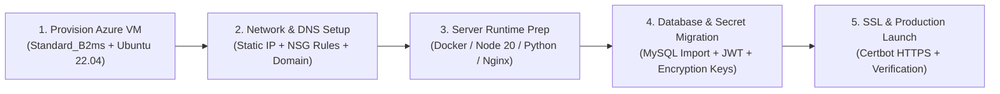

# Momo HRMS — Azure Infrastructure Specification & Technical Architecture Proposal

**Document Version:** 2.0 (Technical Release)  
**Target Organization Size:** Initial 25–30 Active Employees (Scalable to 100+ Employees)  
**System Name:** Momo HRMS (Enterprise Attendance, Biometric Face AI & Geofencing Platform)  
**Target Environment:** Microsoft Azure Virtual Machine (Cloud Hosted)

---

## 1. Executive Summary

This document specifies the technical compute, memory, storage, networking, and architecture requirements to host **Momo HRMS** on **Microsoft Azure**.

Momo HRMS is an enterprise human resource and real-time biometric attendance platform comprising:
- **6 Microservices (Node.js / NestJS):** API Gateway, Authentication Service, Attendance Engine, Geofence Tracking Service, Employee Record Service, In-App / SSE Notification Service.
- **1 Biometric Neural Engine (Python FastAPI / OpenCV):** Deep face detection (YuNet) and recognition (SFace / ArcFace) with liveness verification running on CPU via OpenCV DNN.
- **1 Relational Database Engine:** MySQL 8.0 (InnoDB engine with isolated service databases).
- **1 Web Administrative Portal:** React SPA served via Nginx with automated SSL/TLS termination.
- **Mobile Client Applications:** React Native Expo applications running on Android and iOS.

For an organization with **25 to 30 active employees**, all backend services, the Face AI engine, the database, and reverse proxy run reliably on a **single Azure Virtual Machine**, delivering high performance and operational simplicity.

---

## 2. Recommended Azure Virtual Machine Specifications

| Hardware Specification | Minimum Requirement (Budget Tier) | **Recommended Specification (Production Tier)** | Architectural Rationale |
| :--- | :--- | :--- | :--- |
| **Azure VM SKU / Family** | `Standard_B2s` | **`Standard_B2ms`** (Recommended) | Burstable B-series accumulates CPU credits during off-hours and unleashes 100% capacity during morning attendance check-in bursts |
| **Compute (vCPU)** | 2 vCPUs | **2 vCPUs** (Intel Xeon / AMD EPYC) | Handles concurrent Node.js asynchronous event loops and multi-threaded Face AI vector math |
| **Memory (RAM)** | 4 GB RAM (+ 4 GB Swap) | **8 GB RAM** | Sufficient headroom for all 7 application runtimes, MySQL buffer pool, and Linux disk page caching |
| **Storage (ROM / Disk)** | 32 GB Standard SSD | **64 GB – 128 GB Premium SSD (P6/P10)** | Dedicated IOPS (up to 1,100 IOPS) ensuring sub-millisecond database queries and fast biometric image processing |
| **Operating System** | Ubuntu Server 22.04 LTS x64 | **Ubuntu Server 24.04 LTS / 22.04 LTS x64** | Standard, hardened Linux LTS enterprise distribution |
| **Public IP** | Dynamic IPv4 | **1 Static Public IPv4 Address (Standard SKU)** | Required for mobile client DNS resolution, firewall whitelisting, and automated SSL certificate renewal |
| **High-Scale Readiness** | Scale up to ~50 users | **Scale up to 150+ users (500+ with Redis)** | Handles organization growth without infrastructure redeployment |

> [!TIP]
> **Why `Standard_B2ms` (2 vCPU / 8 GB RAM) is Selected:**
> Attendance systems have a **concentrated spike profile**. Between 08:30 AM and 09:30 AM, employees arrive and perform simultaneous face biometric validations and geofence location checks. 
> - The **B-series burstable architecture** is ideal: it banks credits when the office is working quietly and releases full performance during peak check-in/check-out windows.
> - **8 GB RAM** ensures that the Linux kernel, MySQL InnoDB buffer pool, Face AI neural model, and all microservices operate with **over 4.5 GB of free operating buffer**, preventing Out-Of-Memory (OOM) process termination.

---

## 3. Workload Architecture & Subsystem Memory Allocation

```
+------------------------------------------------------------------------------------+
|                          MICROSOFT AZURE VIRTUAL MACHINE                           |
|                         Standard_B2ms [2 vCPU | 8 GB RAM]                          |
+------------------------------------------------------------------------------------+
|                                                                                    |
|  [ Inbound HTTPS (443) / HTTP (80) ]                                               |
|         │                                                                          |
|         ▼                                                                          |
|  ┌─────────────────────────────────────────────────────────────┐                   |
|  │ NGINX Reverse Proxy + Let's Encrypt TLS 1.3                 │ ~50 MB RAM        |
|  │ (Web Frontend SPA + SSL Termination + Request Forwarding)   │                   |
|  └──────────────┬──────────────────────────────────────────────┘                   |
|                 │ http://localhost:8000                                            |
|                 ▼                                                                  |
|  ┌─────────────────────────────────────────────────────────────┐                   |
|  │ API Gateway (:8000) [Node.js / NestJS]                      │ ~120 MB RAM       |
|  └──────────────┬──────────────────────────────────────────────┘                   |
|                 │ Internal Signature & Header Routing                              |
|                 ├──────────────────────────┬──────────────────────────┐            |
|                 ▼                          ▼                          ▼            |
|  ┌─────────────────────────────┐ ┌────────────────────┐ ┌────────────────────────┐ |
|  │ Auth Service (:3001)        │ │ Attendance (:3002) │ │ Geofence (:3003)       │ |
|  │ ~120 MB RAM                 │ │ ~140 MB RAM        │ │ ~110 MB RAM            │ |
|  └─────────────────────────────┘ └────────────────────┘ └────────────────────────┘ |
|                 ├──────────────────────────┼──────────────────────────┤            |
|                 ▼                          ▼                          ▼            |
|  ┌─────────────────────────────┐ ┌────────────────────┐ ┌────────────────────────┐ |
|  │ Employee Records (:3004)    │ │ Notification(:3005)│ │ Face AI Engine (:3006) │ |
|  │ ~140 MB RAM                 │ │ ~120 MB RAM        │ │ ~350 MB RAM            │ |
|  └─────────────────────────────┘ └────────────────────┘ └────────────────────────┘ |
|                                            │                                       |
|                                            ▼ (SQL Transactions)                    |
|  ┌─────────────────────────────────────────────────────────────┐                   |
|  │ MySQL 8.0 Database (Dedicated schemas per microservice)     │ ~800 MB - 1.2 GB  |
|  └─────────────────────────────────────────────────────────────┘                   |
|                                                                                    |
|  ┌─────────────────────────────────────────────────────────────┐                   |
|  │ Linux OS (Ubuntu 22.04 LTS), Logging, Docker Daemon         │ ~600 MB RAM       |
|  └─────────────────────────────────────────────────────────────┘                   |
|                                                                                    |
|  Active Base Memory Allocation: ~3.0 GB                                            |
|  Available Headroom & Cache:    ~5.0 GB (Fast Linux page cache & DB buffers)       |
+------------------------------------------------------------------------------------+
```

### Detailed Service Footprint Table

| Service / Subsystem | Technology Stack | Base RAM | Peak RAM (Bursts) | Typical CPU Usage |
| :--- | :--- | :--- | :--- | :--- |
| **API Gateway** | Node.js (NestJS) | 90 MB | 140 MB | 2–5% |
| **Auth Service** | Node.js (NestJS) | 100 MB | 130 MB | 1–3% |
| **Attendance Service** | Node.js (NestJS) | 110 MB | 160 MB | 3–8% (high at shift starts) |
| **Geofence Service** | Node.js (NestJS) | 90 MB | 120 MB | 2–4% (spatial math calculation) |
| **Employee Service** | Node.js (NestJS) | 110 MB | 150 MB | 1–3% |
| **Notification Service** | Node.js (NestJS) | 90 MB | 130 MB | 1–4% (SSE live stream) |
| **Face AI Engine** | Python 3.11 / OpenCV | 280 MB | 450 MB | 15–30% for ~50ms per scan |
| **MySQL 8.0 Engine** | MySQL InnoDB Server | 700 MB | 1,200 MB | 5–15% |
| **Nginx Web Server** | Nginx Alpine | 30 MB | 60 MB | < 1% |
| **Linux OS & System** | Ubuntu 22.04 LTS | 500 MB | 700 MB | 1–2% |
| **TOTALS** | — | **~2.3 GB** | **~3.5 GB** | **Comfortably fits in 8 GB RAM** |

---

## 4. Geofence Location Polling Interval Impact Analysis

During an active working shift, the mobile application continuously monitors whether the employee remains inside the designated office polygon boundary.

The geofence location verification request frequency (`POST /api/v1/geofence/verify`) has a direct impact on:
1. **Server API Volume & Database Load**.
2. **Azure VM CPU Burstable Credit Consumption**.
3. **Mobile Device Battery Consumption & Thermal State**.
4. **Network Data Consumption** (Mobile cellular data).
5. **Geofence Exit/Return Detection Latency**.

### Comparative Impact Matrix (30 Employees, 8-Hour Workday)

| Operational Metric | **Option A: 30 Seconds** (Current) | **Option B: 1 Minute (60s)** ⭐ *(Recommended)* | **Option C: 2 Minutes (120s)** *(Ultra-Low Load)* |
| :--- | :--- | :--- | :--- |
| **Requests / Minute (Total)** | **60 req/min** (1.0 req/sec) | **30 req/min** (0.5 req/sec) | **15 req/min** (0.25 req/sec) |
| **Requests / Hour (Total)** | **3,600 req/hr** | **1,800 req/hr** *(50% reduction)* | **900 req/hr** *(75% reduction)* |
| **Daily API Calls (8-hr shift)** | **28,800 calls/day** | **14,400 calls/day** | **7,200 calls/day** |
| **Monthly API Calls (22 days)** | **~633,600 calls/month** | **~316,800 calls/month** | **~158,400 calls/month** |
| **Monthly Network Bandwidth** | ~380 MB / month | ~190 MB / month | ~95 MB / month |
| **Database Queries (MySQL)** | 60 queries/min | 30 queries/min | 15 queries/min |
| **Azure VM CPU Impact** | 3% – 6% steady | **1.5% – 3% baseline** | **0.8% – 1.5% baseline** |
| **Mobile Battery Usage / Shift** | 3% – 5% drain | **1.5% – 2.5% drain** *(~50% less)* | **< 1.5% drain** |
| **Exit Detection Latency** | ~30 – 45 seconds | **~60 seconds (1 minute)** | **~120 seconds (2 minutes)** |
| **Scalability on `Standard_B2ms`**| ~80 employees | **~160 employees** | **~300 employees** |

---

### Technical Evaluation of Options

#### Option A: 30 Seconds Interval (Current Setting)
- **Characteristics:** Near-instantaneous geofence state reflection.
- **Limitation:** Generates ~28,800 requests/day for 30 employees. The mobile device GPS chip wakes up every 30 seconds, which increases battery drain on older smartphones.

#### Option B: 1 Minute / 60 Seconds Interval (Recommended Sweet Spot ⭐)
- **Key Advantages:**
  - **Cuts total daily server requests and database reads by exactly 50%** (from 28,800 down to 14,400 calls/day).
  - Significantly lowers mobile battery consumption (~50% fewer GPS polling wake-ups).
  - **1-minute detection latency is completely safe:** Momo HRMS includes a configurable grace period (e.g. 15–60 minutes) for temporary departures or indoor GPS drift. A 60-second polling cycle is undetectable to employees and HR admins.
  - Doubles the organization's growth capacity on the exact same Azure VM.

#### Option C: 2 Minutes / 120 Seconds Interval (Ultra-Low Footprint)
- **Key Advantages:**
  - **Cuts server load by 75%** (only 7,200 calls/day for 30 employees).
  - Negligible mobile battery impact (< 1.5% over an entire workday).
- **Trade-off:**
  - Latency is up to 2 minutes. When an employee leaves the office, their status on the live HR dashboard will remain `INSIDE` for up to 120 seconds before transitioning to `OUTSIDE`.

---

## 5. Future Scalability: Implementing Redis to Reduce System Load

Momo HRMS is pre-architected with configuration flags (`REDIS_ENABLED`) to allow inserting an in-memory **Redis 7** caching layer at any point without restructuring core services.

```
[ Mobile App & Web Clients ]
             │
             ▼
[ API Gateway & Microservices ]
     │                    │
     ▼ (Cache Hit: ~1ms)  ▼ (Cache Miss / State Change)
[ Redis 7 In-Memory ] ───► [ MySQL 8.0 Relational DB ]
  (RAM: ~35-50 MB)           (Permanent Disk Storage)
```

### How Redis Reduces Server & Database Load

The table below outlines the specific subsystems where Redis can be activated to offload relational database work:

| Subsystem | Without Redis (Current Direct MySQL) | With Redis In-Memory Layer Activated | Load Reduction Benefit |
| :--- | :--- | :--- | :--- |
| **Geofence Boundary Verification** | Every 30s/60s location check queries MySQL for office coordinates & polygon vertices (~14,400–28,800 DB reads/day). | Office polygon vertices cached in Redis: `geofence:office:{code}:poly` (TTL: 24h, auto-evicted on office edit). | **Eliminates 100% of repeated MySQL queries.** Geofence response latency drops from **~25ms to ~1ms**. |
| **Attendance Check-In Concurrency** | Double-tapping Check-In on poor mobile networks creates concurrent SQL insert attempts. | Atomic distributed lock acquired in Redis: `SET lock:attendance:{empId} NX EX 5`. | **Eliminates race conditions**; rejects duplicate requests in memory before touching MySQL. |
| **Face AI Biometric Matching** | 128D face embeddings fetched from database on every camera scan (~45ms). | 128-float embedding templates cached in Redis (only **15 KB total data** for 30 users). | Face matching latency drops from **~45ms to ~15ms**, speeding up employee entrance flow. |
| **Authentication & Brute Force Rate Limiting** | Rate limiting stored in Node process memory; resets upon container restarts. | Persistent sliding-window rate limit counters stored in Redis (`@nestjs/throttler`). | Protects login endpoints from brute-force attacks across server restarts with zero database overhead. |
| **Active Session State Lookups** | Every home screen refresh triggers SQL queries to check active session status. | Active session cached in RAM: `attendance:active:{empId}`. | Speeds up mobile home screen loading to near-instantaneous. |

---

### System Load Comparison: Current Architecture vs With Redis Layer

| System Performance Metric | Current Architecture (Direct MySQL) | With Redis Layer Added | Overall Impact |
| :--- | :--- | :--- | :--- |
| **Daily MySQL Read Queries (30 emp)** | **~35,000 queries/day** | **~2,000 queries/day** | **> 90% reduction in database load** |
| **Geofence API Response Time** | ~15 ms – 35 ms | **~1 ms – 3 ms** | **10x faster verification** |
| **Face Verification Speed** | ~40 ms – 55 ms | **~15 ms – 20 ms** | Faster mobile check-in experience |
| **Redis Server Memory Footprint** | 0 MB | **~35 MB – 50 MB RAM** | Negligible impact on an 8 GB system |
| **Total Active Memory on VM** | ~2.5 GB RAM | **~2.6 GB RAM** | Leaves **> 4.8 GB free headroom** |
| **Required Azure VM SKU** | `Standard_B2ms` (8 GB) | **`Standard_B2ms` (8 GB)** | **Exact same server; no upgrade needed** |
| **Scaling Capacity on Same VM** | ~80 – 150 active employees | **500+ active employees** | **Multiplies server capacity by 3x–4x** |

> [!NOTE]
> **Summary on Redis Implementation:**  
> For the initial rollout of **25–30 employees**, Redis is not mandatory because MySQL easily handles 0.5–1 query/sec. However, because a self-hosted `redis:7-alpine` Docker container consumes only **~40 MB RAM**, deploying it on the same `Standard_B2ms` Azure VM allows the organization to scale smoothly to **500+ employees** in the future without database bottlenecks or cloud server upgrades.

---

## 6. Storage & ROM Sizing (64 GB vs 128 GB)

For 25–30 employees, data volume growth is modest, but **SSD IOPS and burst throughput** are essential for rapid database writes and image template processing.

### Projected Disk Space Utilization (Over 2 Years)

```
[ Ubuntu OS + System Packages ] ────────────► 8.0 GB
[ Docker Images & Node/Python Runtimes ] ──► 12.0 GB
[ MySQL Database (25-30 employees x 2 yrs) ] 2.5 GB
[ Face Biometric Templates (Encrypted 128D) ] 0.05 GB (Extremely compact)
[ Employee Profile Photos & Audit Snaps ] ──► 8.0 GB
[ System Swap File (Safety fallback) ] ────► 4.0 GB
[ Application Logs (Logrotated 30 days) ] ──► 4.0 GB
[ Free Operating Buffer / Temp Files ] ─────► 25.45 GB
────────────────────────────────────────────────────────
TOTAL DISK ALLOCATION:                        64.0 GB (Premium SSD)
```

> [!NOTE]
> **Managed Disk Recommendation:** Specify **Premium SSD (P6 - 64 GB or P10 - 128 GB)** in Azure. Premium SSD provides dedicated IOPS (up to 1,100 IOPS on P10) with sub-millisecond read/write latency.

---

## 7. Network & Security Architecture

### Azure Network Security Group (NSG) Inbound Rules

Only standard web ports are exposed to the public internet. All internal microservice ports (3001–3006, 8000, 3306, 6379) remain bound to `localhost` / private virtual network.

| Priority | Direction | Port | Protocol | Source | Action | Purpose |
| :--- | :--- | :--- | :--- | :--- | :--- | :--- |
| **100** | Inbound | `443` | TCP | `Any` (Internet) | **Allow** | HTTPS for Mobile App & Web Management Portal |
| **110** | Inbound | `80` | TCP | `Any` (Internet) | **Allow** | HTTP for automatic HTTPS redirect & Let's Encrypt renewal |
| **120** | Inbound | `22` | TCP | `Company Office IP` / VPN | **Allow** | Secure SSH administration (blocked for general public) |
| **4096**| Inbound | `All` | Any | `Any` | **Deny** | Default deny-all security baseline |
| **100** | Outbound | `587` | TCP | `Any` | **Allow** | SMTP TLS email delivery (Google Workspace / Office 365) |
| **110** | Outbound | `443` | TCP | `Any` | **Allow** | OS updates, Docker registry, NTP time sync |

### Domain & SSL/TLS Configuration
- **DNS Record:** 1 A-Record mapping company subdomain (e.g. `hrms.yourcompany.com`) to the Azure VM Static Public IP.
- **SSL Certificate:** Free, auto-renewing Let's Encrypt TLS 1.3 certificate configured via Certbot and Nginx.

---

## 8. Deployment Roadmap



1. **Step 1: Provisioning:**
   - Resource Group: `rg-momo-hrms-prod`.
   - VM SKU: `Standard_B2ms` in the preferred Azure region with Ubuntu Server 22.04 LTS and SSH key authentication.
   - Attach 64 GB Premium SSD.
2. **Step 2: DNS & Networking:**
   - Associate a Standard Static Public IP.
   - Configure NSG inbound rules (443, 80, restricted 22).
   - Point `hrms.company.com` to the Azure Static IP.
3. **Step 3: Runtime Installation:**
   - Install Docker & Docker Compose plugin (or PM2 + Node 20 + Python 3.11 virtual environment).
   - Install Nginx reverse proxy.
4. **Step 4: Data & Environment Setup:**
   - Initialize MySQL 8.0 databases (`auth_service`, `attendance_service`, `employee_db`, `geofence_db`, `notification_db`, `face_ai_db`).
   - Run Prisma migrations & seed super-admin/HR accounts.
   - Set production environment variables (JWT secrets, SMTP credentials, encryption keys).
5. **Step 5: SSL & Launch:**
   - Issue SSL certificate with `certbot --nginx -d hrms.company.com`.
   - Update mobile app `API_URL` to point to `https://hrms.company.com`.
   - Verify health endpoints (`/health`) across all services.

---

## 9. Requisition Checklist for Company IT / Cloud Team

When submitting the infrastructure requisition ticket to company IT, you can directly provide this concise specification:

> **Subject:** Infrastructure Requisition: Azure Virtual Machine for Momo HRMS Deployment  
> **Target Workload:** Production HR & Biometric Attendance System (25–30 Users, Scalable to 100+)  
>
> **Requested Infrastructure:**
> 1. **Compute (VM SKU):** `Standard_B2ms` (2 vCPUs, 8 GB RAM, Burstable)  
> 2. **Operating System:** Ubuntu Server 22.04 LTS (x64 Gen 2)  
> 3. **Disk / Storage:** 64 GB Premium SSD (Managed OS Disk)  
> 4. **Public IP:** 1 Static Public IPv4 Address (Standard SKU)  
> 5. **Network Security Group (NSG) Inbound Rules:**
>    - Port 443 (HTTPS) → Open to Internet (0.0.0.0/0)
>    - Port 80 (HTTP) → Open to Internet (for ACME SSL challenge & redirect)
>    - Port 22 (SSH) → Restricted to Company Office IP / VPN
> 6. **DNS:** A-Record for `hrms.<company_domain>.com` pointing to the allocated Static IP
> 7. **Outbound Access:** Port 587 allowed for corporate SMTP notification emails
